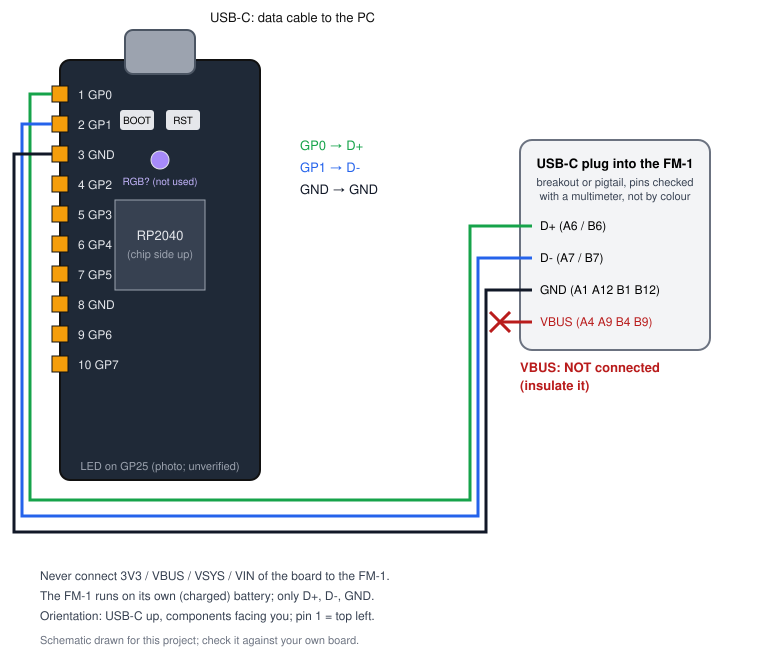

# Guida hardware: DollaTek RP2040 Core Board USB-C come FM-1 Transporter

Questa guida spiega come usare la **DollaTek RP2040 Core Board TYPE-C** (venduta come
"16M") al posto della Seeed XIAO RP2040 per recuperare un M-VAVE FM-1 che non si accende e
non compare via USB. Riguarda il profilo firmware `dollatek_rp2040_typec`.

> **Stato di validazione (ottobre 2026): BUILD VERIFIED.** Il firmware per questa scheda
> compila, l'immagine UF2 è verificata, il protocollo è stato provato in simulazione. **Nessuna
> DollaTek fisica è stata ancora collaudata.** Fino a quando non avrai completato le fasi A e B
> della [procedura di collaudo](#7-collaudo-su-windows-11), considera ogni passo come una
> verifica, non come una procedura già dimostrata. Il riferimento collaudato resta la XIAO.

Indice: [1 Identificazione](#1-identificazione-della-scheda) ·
[2 Pinout](#2-pinout) · [3 Alimentazione e cavo](#3-alimentazione-usb-c-e-cavo-dati) ·
[4 Collegamento al FM-1](#4-collegamento-al-fm-1) · [5 USB nativa e PIO USB](#5-usb-nativa-e-pio-usb) ·
[6 Firmware UF2](#6-firmware-uf2) · [7 Collaudo](#7-collaudo-su-windows-11) ·
[8 Log](#8-interpretazione-dei-log) · [9 Diagnostica FM-1](#9-procedura-diagnostica-fm-1-sola-lettura) ·
[10 Quando fermarsi](#10-criteri-per-interrompere-il-recupero)

---

## 1. Identificazione della scheda

| Caratteristica | Dichiarata dal venditore | Verificata? | Come verificarla |
|---|---|---|---|
| SoC | Raspberry Pi RP2040 | no | scritta sul chip quadrato centrale: `RP2-B2` / `RP2040` |
| Flash QSPI | 16 MB (esistono varianti 2/4/8 MB) | **no** | `fm1-board-tool transporter-info` → `flash_jedec`, `flash_sfdp_bytes` (letti dal firmware all'avvio) |
| Quarzo | non dichiarato (12 MHz necessari) | indiretta | se la scheda compare come disco `RPI-RP2`, il quarzo è da 12 MHz (la ROM USB dell'RP2040 lo richiede) |
| Pulsanti | BOOT e RST | dalla foto | ispezione visiva |
| LED | indicato su GP25 | **no** | `selftest --interactive` (test LED) |
| Componente luminoso centrale | interfaccia non dichiarata | **no** | non usato dal firmware |
| Connettore | USB-C | sì (foto) | — |

Note:

- La DollaTek **non** è una XIAO: ha il formato e la numerazione dei pin del Raspberry Pi
  Pico (pin 1 = GP0 in alto a sinistra), ha un profilo firmware distinto e un UF2 distinto.
- Il pinout e la disposizione (BOOT, RST, LED su GP25, LED RGB centrale) somigliano alle schede
  "YD-RP2040" (VCC-GND Studio), dove il LED RGB è un WS2812 su GP23 e GP24 è un pulsante utente.
  **È un'ipotesi non verificata**: il firmware non pilota mai GP23 e GP24 (sono marcati come
  riservati nel profilo) e non usa il LED RGB.
- La flash dichiarata da 16 MB **non viene data per buona**. Il firmware è costruito in modo
  conservativo (vedi [6](#6-firmware-uf2)) e funziona con qualsiasi flash SPI da almeno 2 MB.

## 2. Pinout

Scheda con il connettore USB-C **in alto** e i componenti **verso di te**. Lato sinistro,
dall'alto (dalla foto del venditore; uguale al Raspberry Pi Pico):

| Pin | Segnale | Uso nel Transporter |
|---|---|---|
| 1 | **GP0** | **FM-1 USB D+** (clock della USB_KEY, poi D+ dell'host PIO USB) |
| 2 | **GP1** | **FM-1 USB D-** (dati della USB_KEY, poi D- dell'host PIO USB) |
| 3 | **GND** | **massa comune con l'FM-1** |
| 4 | GP2 | libero |
| 5 | GP3 | libero |
| 6 | GP4 | libero |
| 7 | GP5 | libero |
| 8 | GND | massa alternativa (riferimento) |
| 9 | GP6 | libero |
| 10 | GP7 | libero |

Altri pin rilevanti: GP25 = LED (dalla foto, non verificato); GP23/GP24 = mai usati.
**3V3, VBUS, VSYS, VIN non vanno mai collegati all'FM-1.**



Perché GP0/GP1:

- Pico-PIO-USB (l'host USB software) usa la configurazione `PIO_USB_PINOUT_DPDM`: D- deve essere
  **il GPIO successivo** a D+. Anche il programma PIO della USB_KEY pilota i due pin come un
  gruppo consecutivo. GP0/GP1 rispettano il vincolo (il build lo verifica: `D- = D+ + 1`).
- Sono gli stessi GPIO della XIAO (dove si chiamano D6/D7), quindi il firmware collaudato non
  cambia: cambia solo la posizione fisica.
- Sulla DollaTek GP0/GP1 non hanno altre funzioni attive: il firmware non abilita UART, I2C o
  SPI su questi pin (il build fallisce se lo stdio UART venisse abilitato).

## 3. Alimentazione, USB-C e cavo dati

- La DollaTek è alimentata **solo** dalla sua porta USB-C, collegata al PC.
- Usa un **cavo USB-C dati**. Un cavo di sola ricarica alimenta la scheda (il LED può
  accendersi) ma il PC non vede né il disco `RPI-RP2` né le porte COM. Il primo test
  (BOOTSEL) serve proprio a escludere questo problema.
- Collega la scheda direttamente al PC (evita hub non alimentati durante il collaudo).
- L'FM-1 resta alimentato dalla **sua batteria**: caricalo completamente prima di iniziare.
  Il suo connettore USB-C è occupato dai fili del Transporter, quindi non può caricarsi durante
  la procedura.

## 4. Collegamento al FM-1

Tre fili soltanto:

| DollaTek | FM-1 (USB-C) | Contatti della spina USB-C |
|---|---|---|
| pin 1 **GP0** | **D+** | A6 (B6) |
| pin 2 **GP1** | **D-** | A7 (B7) |
| pin 3 **GND** | **GND** | A1, A12, B1, B12 |
| — | **VBUS: NON collegare** | A4, A9, B4, B9 |

### 4.1 Pigtail USB-C → Dupont

Il cavo usato con la XIAO (USB-C maschio con 4 fili) ha di solito rosso = VBUS, bianco = D-,
verde = D+, nero = GND. **Non fidarti dei colori**: alcuni produttori li invertono.
Prima di collegare, verifica ogni filo col multimetro:

1. multimetro in modalità continuità (cicalino);
2. una punta sul contatto della spina USB-C (A6 = D+, A7 = D-, A1/A12 = GND, A4/A9 = VBUS;
   la numerazione è stampata sulle schede breakout e nei datasheet dei connettori);
3. l'altra punta sul pin Dupont: annota quale filo corrisponde a quale segnale;
4. controlla che **non ci sia continuità** tra VBUS e D+, D- o GND;
5. isola il filo VBUS (nastro o guaina termorestringente) in modo che non possa toccare nulla.

Se i contatti della spina sono troppo piccoli da raggiungere, usa una breakout (sotto).

### 4.2 Breakout USB-C (consigliato)

Una schedina **USB-C maschio** con piazzole etichettate (`D+`, `D-`, `GND`, `VBUS`) elimina
l'ambiguità dei colori:

- inseriscila nell'FM-1 e collega i fili alle piazzole `D+`, `D-`, `GND`;
- lascia libera la piazzola `VBUS` (e `CC`/`SBU` se presenti);
- se la breakout ha resistenze su CC, non servono e non danno fastidio: senza VBUS non c'è
  negoziazione USB-C;
- verifica comunque col multimetro la continuità piazzola → contatto della spina: anche le
  serigrafie possono essere sbagliate.

### 4.3 Verifiche col multimetro (obbligatorie prima della fase B)

| Misura | Atteso |
|---|---|
| continuità DollaTek pin 1 (GP0) ↔ D+ della spina che entra nell'FM-1 | sì |
| continuità DollaTek pin 2 (GP1) ↔ D- | sì |
| continuità DollaTek pin 3 (GND) ↔ GND | sì |
| continuità VBUS ↔ D+, D-, GND | **no** |
| continuità GP0 ↔ GP1 | **no** (nessun corto) |

Altre regole:

- fili corti (10-20 cm), D+ e D- della stessa lunghezza, lontani da alimentatori;
- nessuna resistenza in serie: il montaggio collaudato sulla XIAO collega i GPIO direttamente;
- livelli logici: i GPIO RP2040 lavorano a 3,3 V, come le linee USB full-speed; non serve
  adattamento (stessa configurazione collaudata con la XIAO);
- D+ e D- invertiti non danneggiano nulla: l'FM-1 semplicemente non risponde (il log lo segnala
  con `D- pulled up instead of D+`).

## 5. USB nativa e PIO USB

La DollaTek usa **due USB diverse**, da non confondere:

| | USB nativa (porta USB-C della DollaTek) | PIO USB (GP0/GP1) |
|---|---|---|
| verso | PC | FM-1 |
| hardware | controller USB dell'RP2040 | software: Pico-PIO-USB sul blocco PIO1 |
| ruolo | dispositivo (2 porte seriali COM + interfaccia di reset) | host USB full-speed |
| stack | TinyUSB device, core 0 | TinyUSB host, core 1 |

Il PC vede la DollaTek come **"FM-1 Transporter"** (USB `2E8A:000A`) con due porte COM:

- **interfaccia 0 = console**: stampa il log (`KEY: n packets`, `PULSE`, `HOST`, ...);
- **interfaccia 2 = porta dati**: protocollo a righe usato da `fm1-board-tool` e dallo
  strumento di recupero.

All'avvio, il core 1 usa GP0/GP1 con il blocco **PIO0** per inviare la **USB_KEY** JieLi
(`0x16EF`, D+ = clock, D- = dati), finché la ROM dell'FM-1 risponde; poi invia impulsi da
1 ms e infine passa i due pin all'**host PIO USB** su **PIO1**. Un solo proprietario per volta.
La comparsa delle porte COM dimostra solo che la DollaTek funziona: **non** dimostra che la
comunicazione con l'FM-1 funzioni.

## 6. Firmware UF2

### 6.1 Quale file

| File (in `dist/dollatek_rp2040_typec/`) | Contenuto | Uso |
|---|---|---|
| `fm1_transporter_dollatek_rp2040-noloader.uf2` | firmware senza il loader JieLi | collaudo della scheda (fase A), arrivo fino a UBOOT |
| `fm1_transporter_dollatek_rp2040-placeholder.uf2` | firmware con un segnaposto al posto del loader | **non flashare**: serve a `make-firmware` |
| `fm1_transporter_dollatek_rp2040.uf2` (generato da te) | firmware completo | diagnosi e recupero FM-1 (fase B) |

Il loader `wl82loader.bin` (24064 byte) è un file di terze parti (JieLi, distribuito da
jl-uboot-tool): non è incluso nel repository. Per ottenere il firmware completo senza
compilare:

```powershell
.\fm1-board-tool.cmd make-firmware --board dollatek_rp2040_typec --fetch-loader
```

Lo strumento scarica il loader dal commit fissato di jl-uboot-tool, ne verifica lo SHA-256
(`d41da612…`), lo inserisce nell'immagine e verifica che il risultato coincida byte per byte
con la build registrata nel manifest (`spliced_uf2_sha256`). Il file risultante è in
`artifacts\dollatek_rp2040_typec\`. In alternativa, compila con `scripts\build.ps1 -Loader`.

### 6.2 Scelte conservative del profilo

- **Boot stage 2 `generic_03h`**: usa il comando di lettura `03h`, supportato da qualsiasi flash
  SPI. Più lento del W25Q080 usato su XIAO e Pico, ma non dipende dal modello della flash.
- **Immagine linkata per 2 MB**: non si assume la capacità dichiarata.
- **`copy_to_ram`**: all'avvio tutto il firmware viene copiato in SRAM ed eseguito da lì, quindi
  né la velocità né il tipo della flash influenzano le temporizzazioni USB_KEY e PIO USB.
- **Avvio del quarzo** con margine ×64 (come sulla XIAO).
- **LED**: solo GP25, polarità supposta attiva alta. Se il LED è assente o invertito il firmware
  funziona lo stesso; per non toccare GP25: build con `-DFM1T_LEDS=OFF`.

### 6.3 Caricamento (BOOTSEL)

Automatico (consigliato): `.\fm1-board-tool.cmd flash --board dollatek_rp2040_typec`.
Lo strumento controlla che l'UF2 sia stato costruito per questa scheda, trova il disco
`RPI-RP2` dal suo contenuto (`INFO_UF2.TXT` con `Board-ID: RPI-RP2`, `INDEX.HTM`, etichetta del
volume e unità rimovibile; mai dalla sola lettera), copia il file e attende che la scheda
risponda come Transporter con la scheda e la build attese. Non formatta né cancella nulla.

Manuale:

1. scollega la DollaTek; tieni premuto **BOOT**; collegala al PC; rilascia BOOT;
2. compare un disco **RPI-RP2**; copia il file `.uf2` sul disco;
3. il disco sparisce e compaiono le porte COM "FM-1 Transporter".

Se la scheda esegue già il Transporter, `flash` la riavvia in BOOTSEL da solo (comando
`bootsel` sulla porta dati, oppure il "tocco a 1200 baud" sulla console).

## 7. Collaudo su Windows 11

Prerequisiti: Python 3.8+ (`py -3`), `pyserial` (lo script si offre di installarlo).
Per compilare: estensione VS Code "Raspberry Pi Pico" (installa pico-sdk 2.2.0, Arm GCC, CMake,
Ninja e picotool in `%USERPROFILE%\.pico-sdk`) oppure gli stessi strumenti a mano.

```powershell
git clone --recurse-submodules https://github.com/Nicodesy06/FM1Trasmitter-for-pico
cd FM1Trasmitter-for-pico
.\scripts\build.ps1 -CheckOnly                                  # strumenti presenti?
.\scripts\build.ps1 -Board dollatek_rp2040_typec -FetchLoader   # opzionale: compila
.\fm1-board-tool.cmd list                                       # porte e dischi (non scrive nulla)
```

### Fase A: la DollaTek da sola (niente su GP0/GP1, nessun FM-1)

```powershell
.\scripts\hardware-test.ps1 -Board dollatek_rp2040_typec
```

La procedura guidata chiede: scritte sul chip RP2040 e sulla flash, presenza dei pulsanti; poi
BOOTSEL col cavo dati, caricamento dell'UF2 e il self-test completo:

| Verifica | Che cosa dimostra |
|---|---|
| BOOTSEL / RPI-RP2 | cavo dati OK, ROM di avvio RP2040, quarzo 12 MHz |
| caricamento UF2 e riavvio | la flash accetta l'immagine; il firmware parte (anche da RAM) |
| enumerazione CDC, console/dati distinte | USB nativa e descrittori corretti |
| `ident` | scheda, versione firmware, build id, pin D+/D- |
| `hwinfo` | clk_sys 120 MHz, JEDEC/SFDP della flash reale, causa dell'ultimo reset |
| `diag` + `piotest` | PIO0 possiede GP0/GP1 e la USB_KEY fa commutare i pad (rilettura interna) |
| test LED | il LED su GP25 esiste e lampeggia (lo confermi tu) |
| console | il log arriva (`KEY: n packets` ogni 2 s) |
| riavvio watchdog | la porta sparisce, viene rilevata la disconnessione, la scheda ritorna con `reset=reboot-cmd` |

Il risultato di ogni voce è **PASS**, **FAIL**, **NOT TESTED**, **REQUIRES FM-1** o
**REQUIRES INSTRUMENTATION**; il report è in `logs\hwtest-dollatek_rp2040_typec-*.md`.
Le voci FM-1 restano `REQUIRES FM-1` finché non esegui la fase B: una porta COM che risponde
non prova che il PIO USB verso l'FM-1 funzioni.

### Fase B: primo contatto con l'FM-1 (sola lettura)

Solo dopo aver superato la fase A, con il firmware **completo** (con loader) e dopo le
misure del [paragrafo 4.3](#43-verifiche-col-multimetro-obbligatorie-prima-della-fase-b):

```powershell
.\scripts\hardware-test.ps1 -Board dollatek_rp2040_typec -Phase b -NoFlash
```

La procedura chiede di confermare una per una le voci della checklist di cablaggio, poi:
scollega e ricollega la DollaTek, **accendi l'FM-1** (era spento), e osserva le fasi
`keying → pulses → host → mounted → uboot`; controlla `key=980F type=3 id=856014`; se
accetti, legge tutta la flash dell'FM-1 **due volte** e salva il dump solo se le due letture
sono identiche (con il file `.json` che lo certifica). **Nulla viene scritto sull'FM-1.**

## 8. Interpretazione dei log

Console (`.\fm1-board-tool.cmd console`), in ordine tipico:

| Riga | Significato | Azione |
|---|---|---|
| `FM-1 Transporter 1.0.0-mb (build …)` / `Board dollatek_rp2040_typec …` | firmware e profilo giusti | — |
| `Board flash …: JEDEC EF4018, SFDP 16777216 bytes` | flash reale della DollaTek (non dell'FM-1) | confronta con i 16 MB dichiarati |
| `KEY: sending 0x16EF, polarity A …` / `KEY: n packets` | USB_KEY in corso, nessuna risposta | accendi l'FM-1 ora |
| `data line probe responds (not proof of a target)` | normale | — |
| `ACK (data line held low) after n packets` | la ROM JieLi ha accettato la chiave | — |
| `D- pulled up instead of D+ - are D+/D- wired swapped?` | D+ e D- invertiti | scambia i due fili |
| `false ACK, D+=0 D-=0` subito dopo l'accensione | transitorio innocuo | nessuna |
| `PULSE: D+ high (ROM pull-up) …` / `PULSE: D+ released after … ms` | calibrazione ROM in corso / completata | — |
| `HANDOFF: pulses stopped, PIO host started in N us` | passaggio a PIO USB | — |
| `HOST: device mounted` / `DEVICE DESCRIPTOR OK` / `VID=4C4A PID=8057` | l'FM-1 è enumerato via PIO USB | — |
| `INQUIRY OK: vendor="WL82" product="UBOOT1.00"` / `UBOOT READY` | UBOOT pronto | `fm1-check` |
| `HOST: no device mounted yet` per molti secondi | nessun dispositivo dopo l'handoff | spegni l'FM-1, ricollega la DollaTek, riaccendi |
| `HOST: D+ pulled up but nothing enumerated … rebooting` | riavvio automatico (max 3) | normale una volta; se si ripete, controlla fili e massa |
| `stock FM-1 application` (`4C4A:C755`) | l'FM-1 ha avviato il firmware V15 originale (quindi non è "brickato") | `fm1-check` si ferma e lo segnala; `info`/`dump` dello strumento di recupero entrano in UBOOT con la soft key USB-MIDI |
| `JL: firmware built without wl82loader.bin` | stai usando l'UF2 `-noloader` | flasha il firmware completo |

Self-test e report: ogni riga riporta anche l'**evidenza** (`HARDWARE` per una scheda reale,
`SIMULATED` per il simulatore). I log completi (livello DEBUG, con ogni comando inviato) sono
in `logs\fm1-board-tool-*.log`.

## 9. Procedura diagnostica FM-1 (sola lettura)

1. FM-1 **spento** e carico; fili collegati e misurati; VBUS isolato.
2. DollaTek collegata al PC (o ricollegata) con il firmware completo: la console mostra `KEY:`.
3. Accendi l'FM-1. Lo schermo resta nero: è previsto.
4. `.\fm1-board-tool.cmd fm1-check --dump backups`
   - attende la fase `uboot` interrogando solo la DollaTek (`diag`), così nessuna richiesta
     resta in coda;
   - `status`, poi `info`: deve dare esattamente `key=980F type=3 id=856014`;
   - legge 1 MiB due volte; salva `backups\fm1-dump-*.bin` + `.json` solo se identiche.
5. Conserva il dump: è il backup del tuo FM-1 così com'è, dati utente compresi.
6. Il recupero vero e proprio (scrittura) avviene **solo** con lo strumento di recupero, in
   un passaggio separato e consapevole:
   ```powershell
   cd recovery
   py -3 fm1_transporter_recover.py setup --board dollatek_rp2040_typec
   py -3 fm1_transporter_recover.py wizard --board dollatek_rp2040_typec --v15 FM-1.fwsc
   ```
   Il wizard rifà la doppia lettura, analizza il dump, mostra il piano (dry run) e chiede di
   digitare `WRITE` prima dell'unico passo che modifica l'FM-1. `restore` rifiuta un dump di
   riferimento che non abbia il file `.json` della doppia lettura. Le aree `0x0000-0x3FFF`
   (boot) e i dati oltre `0x93000` non vengono mai scritti.

La flash da 16 MB della DollaTek e il backup dell'FM-1 sono cose distinte: il firmware della
DollaTek non scrive mai sulla propria flash né, di sua iniziativa, sull'FM-1.

## 10. Criteri per interrompere il recupero

Fermati (FM-1 spento, DollaTek scollegata) se:

- la DollaTek si scalda o Windows segnala un sovraccarico USB;
- il multimetro mostra continuità tra VBUS e D+, D- o GND;
- l'FM-1 reagisce (LED, schermo) mentre è **spento**: viene alimentato dalle linee dati;
  scollega subito;
- dopo l'accensione dell'FM-1 la fase resta `keying` per 60 s: riprova una volta con D+ e D-
  scambiati, poi controlla massa e batteria; non insistere oltre;
- `info` non risponde `key=980F type=3 id=856014`: non è il chip atteso;
- le due letture complete differiscono: il collegamento non è affidabile; accorcia i fili,
  controlla la massa, riprova; **mai** scrivere senza due letture identiche;
- il self-test della fase A riporta un FAIL bloccante;
- qualsiasi passo chiede una conferma che non capisci: in quel caso non digitare `WRITE`.

Non usare mai i pin 3V3, VBUS, VSYS o VIN della DollaTek per alimentare l'FM-1.

---

Documenti collegati: [rapporto di porting e verifiche mancanti](docs/PORTING-REPORT.md) ·
[README](README.md) · guida originale XIAO: [recovery/TRANSPORTER-GUIDE.md](recovery/TRANSPORTER-GUIDE.md)
